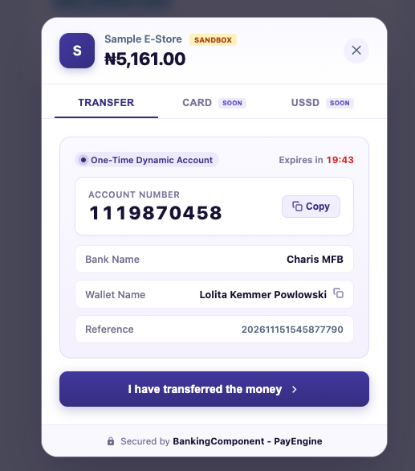
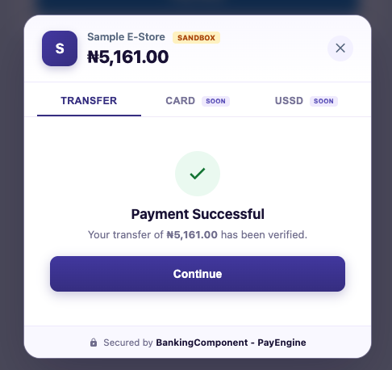

# bankingcomponent-payengine-inline

A modern, standalone, zero-dependency JavaScript payment checkout widget for **BankingComponent PayEngine**. Built with native Vanilla JavaScript and scoped self-injecting styles, it provides dynamic bank transfer checkout sessions, real-time status verification, automatic Sandbox/Production routing, and customizable merchant branding.

## UI Showcase

| Dynamic Bank Transfer | Payment Verification & Success |
| :---: | :---: |
|  |  |
| *One-time virtual account with copy triggers & 20-minute timer* | *Instant settlement confirmation via `payment.verifyStatus`* |

---

## Features

- **Zero External Dependencies**: Lightweight standalone bundle with self-injected scoped CSS.
- **Automatic Environment Routing**: Detects `"test_key"` in your `apiKey` to route requests to the PayEngine Sandbox (`https://sandbox.bankingcomponent.com/payengine/v1`), while live keys automatically route to Production (`https://api.bankingcomponent.com/payengine`).
- **PayEngine Checkout API Integration**:
  - Automatically generates an 18-digit idempotent `initiation_reference` (`YYYYMMDDHHMM` + 6-digit suffix) and initializes checkout via `POST /payment.initiate` (`payment_type: "CHECKOUT"`).
  - Displays the dynamic virtual `receiver_account_number`, `receiver_bank_name`, and `receiver_account_name` with one-click copy triggers and a 20-minute countdown timer.
  - Verifies settlement via `POST /payment.verifyStatus`, validating that `payment_type === "CHECKOUT"` and `status === "SUCCESSFUL"` before confirming payment.
- **Nullable Merchant Branding**: Supports `merchantName` and an optional/nullable `icon` (image URL, Base64 data URI, or inline `<svg>`), automatically falling back to a styled merchant initial badge when `icon` is `null` or omitted.
- **Universal Compatibility**: Works via direct `<script>` tags (CDN) or ES/CommonJS module imports (React, Next.js, Vue, Vite).

---

## Installation

### Via NPM
```bash
npm install bankingcomponent-payengine-inline
```

### Via CDN (`<script>` Tag)
```html
<script src="[https://unpkg.com/bankingcomponent-payengine-inline/dist/checkout.min.js](https://unpkg.com/bankingcomponent-payengine-inline/dist/checkout.min.js)"></script>
```

---

## Quick Start

### 1. Modern Frameworks (React, Next.js, Vue, Vite)

```javascript
import CheckoutWidget from 'bankingcomponent-payengine-inline';

function initiatePayment() {
  const handler = CheckoutWidget.setup({
    // Keys containing "test_key" automatically route to Sandbox
    apiKey: 'test_key_marchant0001',
    walletId: 'WAL-EWDFHP33',
    merchantName: 'Sample E-Store',
    icon: null, // Optional: URL, base64 data URI, inline <svg>, or null
    amount: 5000, // Amount in major currency units (e.g., ₦5,000.00)
    fee: 100,
    currency: 'NGN',
    narration: 'Premium Plan Subscription',
    onSuccess: function (response) {
      console.log('Payment Approved:', response);
      // response: { status: 'SUCCESSFUL', initiation_reference, transaction_reference, amount, currency, channel, raw }
    },
    onCancel: function () {
      console.log('Checkout modal closed by user.');
    },
    onError: function (error) {
      console.error('Checkout Error:', error.message);
    }
  });

  // Open the checkout modal
  handler.open();
}
```

### 2. Plain HTML / Vanilla JavaScript

```html
<!DOCTYPE html>
<html lang="en">
<head>
  <meta charset="UTF-8" />
  <meta name="viewport" content="width=device-width, initial-scale=1.0" />
  <title>Merchant Storefront</title>
  <script src="[https://unpkg.com/bankingcomponent-payengine-inline/dist/checkout.min.js](https://unpkg.com/bankingcomponent-payengine-inline/dist/checkout.min.js)"></script>
</head>
<body>
  <button id="pay-btn">Pay ₦5,000.00</button>

  <script>
    document.getElementById('pay-btn').addEventListener('click', function () {
      const paymentHandler = CheckoutWidget.setup({
        apiKey: 'test_key_marchant0001',
        walletId: 'WAL-EWDFHP33',
        merchantName: 'Sample E-Store',
        icon: '[https://your-domain.com/icon.png](https://your-domain.com/icon.png)', // Nullable
        amount: 5000,
        fee: 100,
        currency: 'NGN',
        narration: 'Premium Plan Subscription',
        onSuccess: function (response) {
          alert('Payment Approved! Ref: ' + response.initiation_reference);
        },
        onCancel: function () {
          console.log('Payment window closed.');
        },
        onError: function (error) {
          console.error('Error:', error.message);
        }
      });

      paymentHandler.open();
    });
  </script>
</body>
</html>
```

---

## Configuration Options

| Option | Type | Required | Default | Description |
| :--- | :--- | :--- | :--- | :--- |
| `apiKey` | `string` | **Yes** | — | Merchant API key (also accepts `key`). Keys containing `"test_key"` route to Sandbox; live keys route to Production. |
| `walletId` | `string` | **Yes** | — | Destination PayEngine wallet ID to credit (also accepts `wallet_id`). |
| `amount` | `number` | **Yes** | `0` | Checkout amount in major currency units (e.g., `5000` for ₦5,000.00). |
| `fee` | `number` | No | `0` | Optional transaction/processing fee charged. |
| `currency` | `string` | No | `'NGN'` | ISO 4217 3-letter currency code (`NGN`, `USD`, `GHS`, `KES`). |
| `narration` | `string` | No | Auto-generated | Payment description sent to PayEngine. |
| `initiationReference` | `string` | No | Auto-generated | Custom 17–18 digit unique numeric reference (`YYYYMMDDHHMM` + random digits). |
| `merchantName` | `string` | No | `'Merchant Store'` | Business name displayed in the modal header. |
| `icon` | `string \| null` | No | `null` | Nullable merchant icon (image URL, Base64 data URI, or inline `<svg>`). Also accepts `logo` or `merchantIcon`. |
| `channels` | `string[]` | No | `['transfer', 'card', 'ussd']` | Payment tabs shown in the widget (`transfer` is active; `card` and `ussd` show coming-soon placeholders). |
| `onSuccess` | `function` | No | `function(res){}` | Fired when `payment.verifyStatus` confirms `payment_type === "CHECKOUT"` and `status === "SUCCESSFUL"`. |
| `onCancel` | `function` | No | `function(){}` | Fired when the customer closes or dismisses the checkout modal. |
| `onError` | `function` | No | `function(err){}` | Fired if checkout initialization fails or an invalid payment type is detected. |

---

## Environment Routing

| `apiKey` Pattern | Environment | Base URL |
| :--- | :--- | :--- |
| Contains `"test_key"` (e.g., `test_key_marchant0001`) | **Sandbox** | `https://sandbox.bankingcomponent.com/payengine/v1` |
| All other valid merchant keys | **Production** | `https://api.bankingcomponent.com/payengine` |

---

## Instance Methods

### `handler.open()` / `handler.openIframe()`
Mounts the checkout modal overlay, calls `POST /payment.initiate` (`payment_type: "CHECKOUT"`), renders the virtual bank account details, and starts the 20-minute countdown timer.

### `handler.close()`
Stops active countdown timers, removes the modal from the DOM, and triggers `onCancel` if dismissed before completion.

---

## Callback Payloads

### `onSuccess(response)`
```json
{
  "status": "SUCCESSFUL",
  "initiation_reference": "202611151514643650",
  "transaction_reference": "BC115910D009",
  "amount": 5100,
  "currency": "NGN",
  "channel": "transfer",
  "raw": { "...": "Full PayEngine verifyStatus JSON response" }
}
```

---

## License

MIT © [BankingComponent](https://bankingcomponent.com)